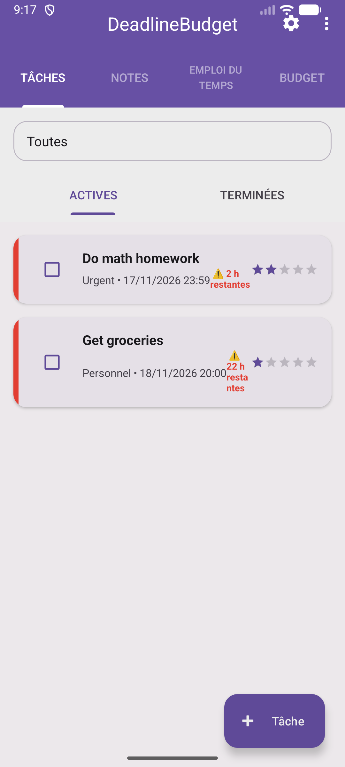
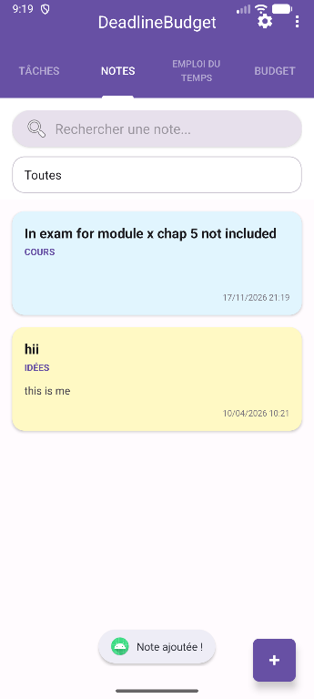
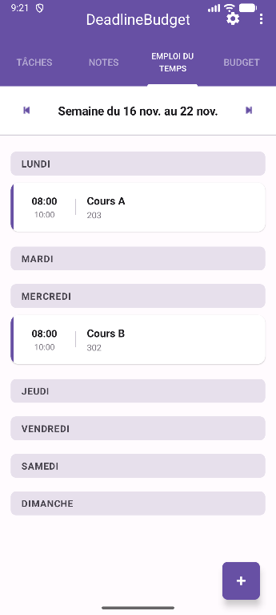
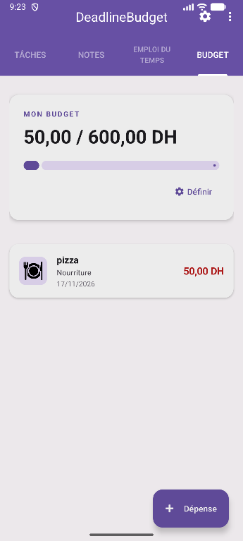
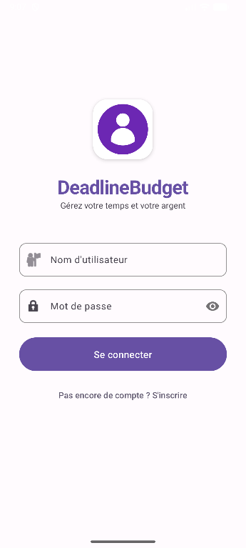
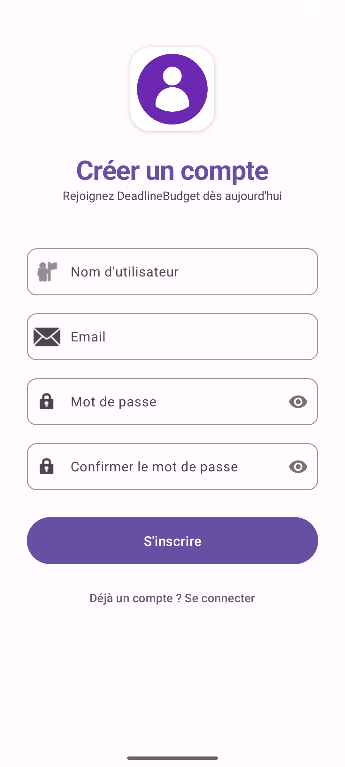
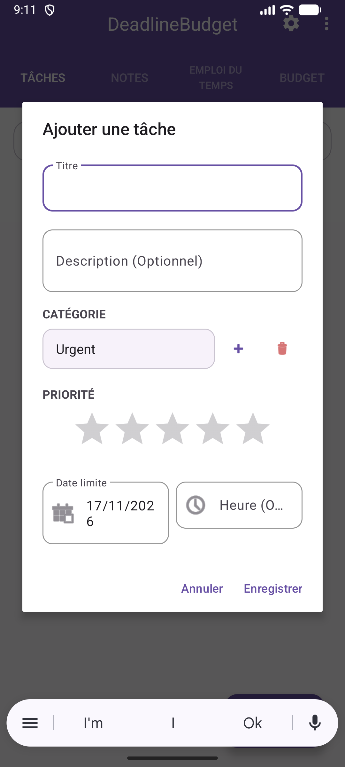
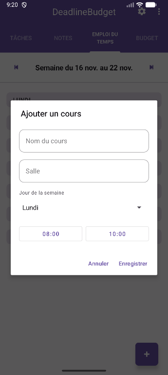
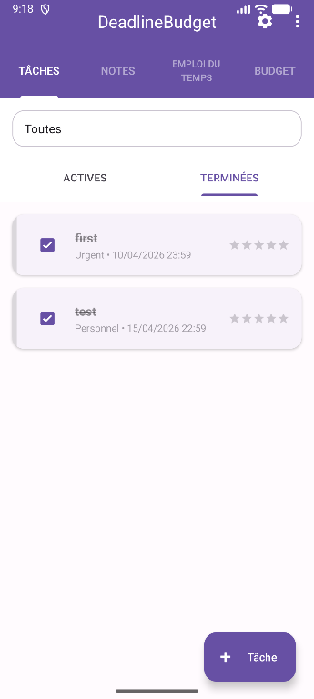
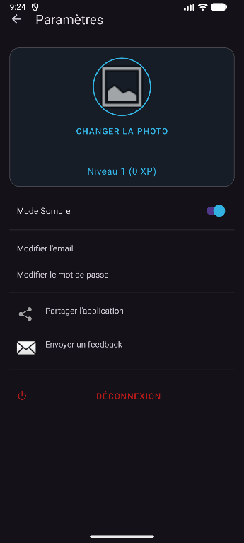

# DeadlineBudget — Student Organizer (Android)

All-in-one Android app for students: **tasks with deadlines, notes, weekly timetable and budget**, with deadline reminders.
Built in Java with Android Studio and a local **Realm** database — Université Internationale de Rabat (April 2026).

| Tasks | Notes | Timetable | Budget |
|---|---|---|---|
|  |  |  |  |

## Features

**Accounts** — sign up / log in, each user has their own data.

**Tasks**
- Title, description, category (custom categories can be added or deleted), priority (1–5 stars), deadline date and time
- Time left shown on each task, overdue/urgent highlighted
- Active / completed lists, filter by category
- **Reminders**: notifications 7 days, 3 days and 1 day before the deadline (AlarmManager)

**Notes** — categories with colours, search, filter by category.

**Timetable** — weekly view (Monday → Sunday) with week navigation; each class has a name, room and time slot.

**Budget** — monthly budget with progress bar, expenses with categories and dates.

**Settings** — profile photo, level / XP, dark mode, change email or password, share the app, send feedback, log out.

Everywhere: **tap** an item to edit it, **long-press** to delete it (with confirmation).

| Login | Sign up | Add a task | Add a class | Completed tasks | Settings (dark mode) |
|---|---|---|---|---|---|
|  |  |  |  |  |  |

## Architecture

```
app/src/main/java/com/example/deadlinebudget/
├── activities/     Login, Signup, Main (tabs), Settings, Detail, AddTacheEmploi
├── fragments/      Task, Note, Schedule, Budget (one per tab, ViewPager2)
├── adapters/       RecyclerView adapters
├── models/         Realm objects: Utilisateur, Tache, Note, Cours, TacheEmploi, Matiere, Depense
├── data/           DataManager — all database operations (Realm)
├── TaskReminderManager / NotificationHelper / *Receiver   Deadline reminders
└── DeadlineBudgetApp   Realm initialisation
```

## Tech stack

Java · Android SDK (min 28 / target 36) · Realm 10.19 · Material Components · ViewPager2 + TabLayout · RecyclerView · AlarmManager + notifications · Gradle

## Run it

1. Open the project in **Android Studio**
2. Let Gradle sync, then click **Run ▶** on an emulator or an Android 9+ phone
3. Create an account from the **S'inscrire** screen

## Known limitations

Data is stored locally on the phone (no server). Passwords are stored in the local Realm database without hashing.

## Author

**Riyad Nouar**
